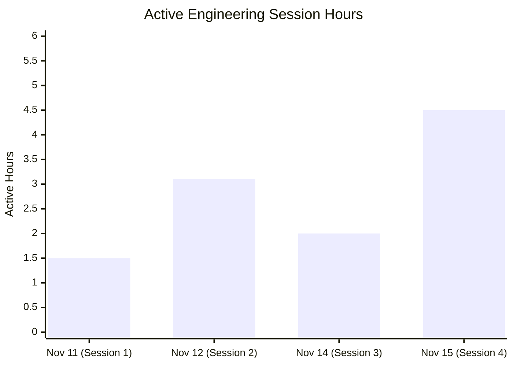
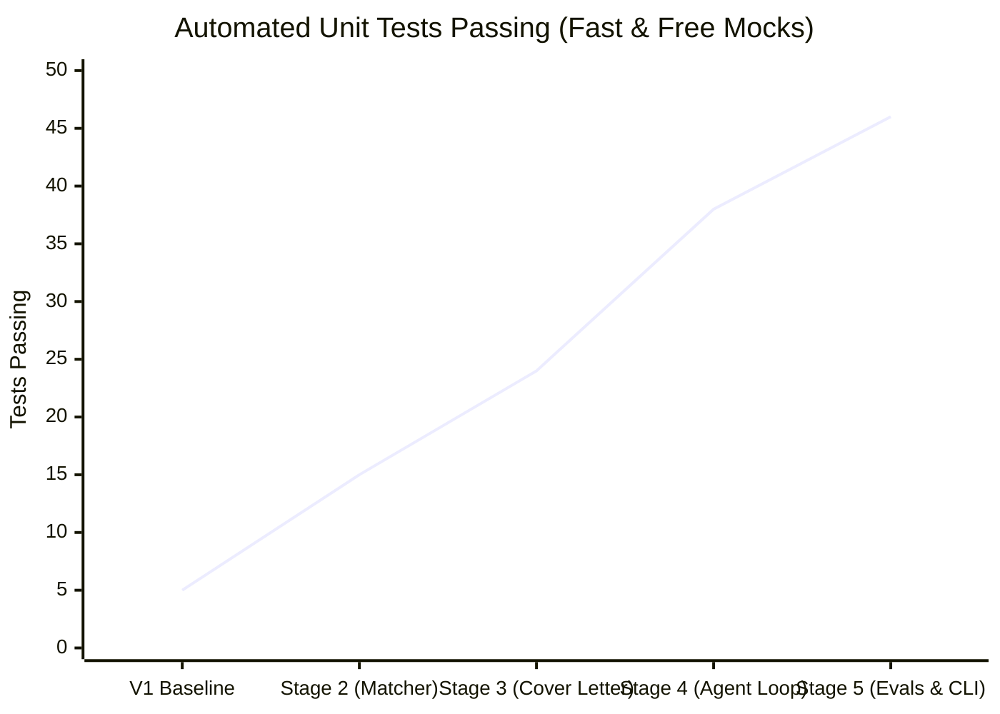
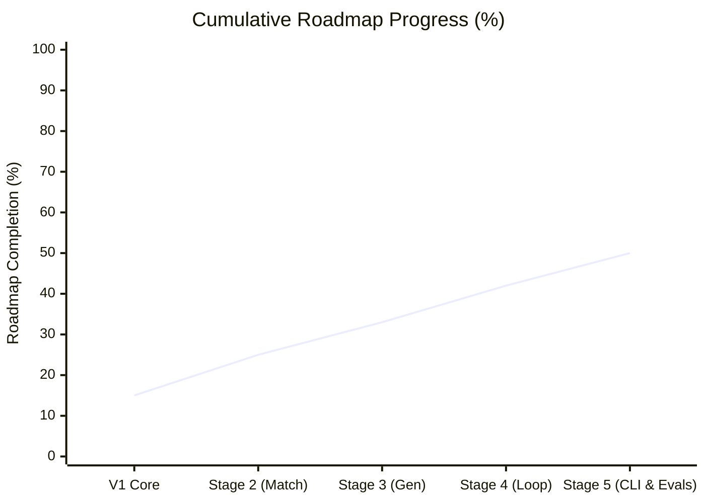

# Engineering Velocity & Session Telemetry

Tracking active engineering hours, feature delivery velocity, test suite growth, and progress toward the 12-stage Autonomous Agentic Engineer roadmap.

---

## Visual Telemetry

### 1. Active Session Hours vs Capacity

### 2. Automated Test Suite Reliability Growth

### 3. Full 12-Stage Roadmap Progress

---

## Capacity Model
- **Weekdays (Mon–Fri):** ~3 hours average target capacity per day (focused sprint on 1 feature + tests + docs).
- **Weekends (Sat–Sun):** Full-day capacity (~6–8 hours) for multi-step architecture leaps.
- **Session Boundary Rule:** 15-minute sliding inactivity window. Any message after 15+ minutes of silence begins a new session.

---

## Session History Log

### Session #4 — Nov 15, 2026 (Weekend Sprint)
- **Time Window:** 09:56 – 14:15 & 21:40 – 23:00 IST
- **Active Duration:** **4 hours 35 minutes** (275 mins)
- **Session Capacity:** Weekend Sprint (~6–8 hours capacity, ~4.5h focused execution)
- **Planned Target:** Commit Stage 4, Build Agent Decision Benchmark (`eval_agent.py`), Build Interactive CLI (`cli.py`), and Architectural Line-by-Line Review
- **Accomplished:**
  - Pushed Stage 4 commit `de97668` to GitHub with content-addressable SHA-256 resume profile caching.
  - Implemented Stage 5 Agent Decision & Safety Benchmark (`eval_agent.py`) with 5 diverse scenarios. Achieved **100% decision gate accuracy** and **100% skill gap recall** in <0.01s without burning API tokens.
  - Built production Interactive Job Hunter CLI (`cli.py`) supporting multiline terminal pasting (`END`), direct file input (`-f`), custom resume paths (`-r`), and headless automation (`--non-interactive`).
  - Added unit test suite `test_cli.py` (8 tests). Cumulative test suite grew from 38 to **46 automated tests** (100% passing in ~0.71s).
  - Completed deep line-by-line architectural walkthrough of `cli.py` controller logic, `argparse` ingestion, and `interactive` Human-in-the-Loop runtime toggling.
  - Wrote technical architecture documentation in `docs/stage5_evals_cli.md` and updated `PROGRESS.md`.
  - Reached **50.0% milestone (6/12 stages)** of the 12-stage Autonomous Agentic Engineer roadmap.
- **Scope Velocity:** **100% of planned target achieved**.
- **Test Suite:** **46 / 46 passing** (grew from 38 to 46).
- **Roadmap Completion:** **50.0%** (6/12 stages complete).

---

### Session #3 — Nov 14, 2026 (Weekday Sprint)
- **Time Window:** 20:30 – 22:30 IST
- **Active Duration:** **2 hours 00 minutes** (120 mins)
- **Session Capacity:** Weekday Sprint (~3 hours)
- **Planned Target:** Stage 4 CLI Agent Loop + Candidate Profile Caching
- **Accomplished:**
  - Implemented Stage 4 hand-built autonomous CLI agent loop (`agent.py`) with `AgentState`, tool orchestration, HITL decision gates, and application packet persistence in `applications/`.
  - Built content-addressable SHA-256 candidate resume profile caching in SQLite `jobs.db` (`db.py`), bypassing Gemini on repeated runs (0ms latency, zero tokens consumed).
  - Wrote comprehensive unit tests (`test_agent.py` and `test_db.py`). Test suite grew from 24 to 38 unit tests (100% passing in ~0.38s).
  - Documented architecture and state machine in `docs/agent_loop.md` and updated `PROGRESS.md`.
- **Scope Velocity:** **100% of Stage 4 target achieved**.
- **Test Suite:** **38 / 38 passing** (grew from 24 to 38).
- **Roadmap Completion:** **41.7%** (5/12 stages complete).

---

### Session #2 — Nov 12, 2026 (Weekday)
- **Time Window:** 20:21 – 23:25 IST
- **Active Duration:** **3 hours 04 minutes** (184 mins)
- **Session Capacity:** Weekday Sprint (~3 hours)
- **Planned Target:** Stage 3 Cover Letter Generator + Stage 4 Kickoff
- **Accomplished:**
  - Diagnosed 59k corrupted PDF bytes; configured `.gitignore` for `*.pdf` and `resume.md`.
  - Ingested authentic candidate background into `resume.md`.
  - Built `generator.py` with anti-AI recruiter prompt, 10s timeout, 503 backoff, 429 fail-fast.
  - Built `test_generator.py` (5 unit tests).
  - Implemented dual-mode `POST /cover-letter` endpoint in `main.py` with `resume.md` fallback.
  - Implemented 4 integration tests in `test_main.py`.
  - Wrote `docs/cover_letter.md` and updated `PROGRESS.md`.
  - Pushed commit `2fc346f` to GitHub.
- **Scope Velocity:** **~78% of planned target achieved** (Stage 3 100% complete, Stage 4 architecture queued).
- **Test Suite:** **24 / 24 passing** (grew from 15 to 24).
- **Roadmap Completion:** **33.3%** (4/12 stages complete).

---

### Session #1 — Nov 11, 2026 (Weekday)
- **Time Window:** 20:47 – 22:20 IST
- **Active Duration:** **1 hour 33 minutes** (93 mins)
- **Planned Target:** Resume Parsing, Deterministic Matching Engine & Batch Ranking (`/match-all`).
- **Accomplished:**
  - Implemented Stage 2 core: `resume.py`, `test_resume.py`, `matcher.py`, `test_matcher.py`.
  - Implemented `POST /match` and `POST /match-all` against SQLite `jobs.db`.
  - Tested batch ranking leaderboard (<2ms in-memory execution).
- **Scope Velocity:** **100% of Stage 2 target achieved**.
- **Test Suite:** **15 / 15 passing** (grew from 5 to 15).
- **Roadmap Completion:** **25%** (3/12 stages complete).
