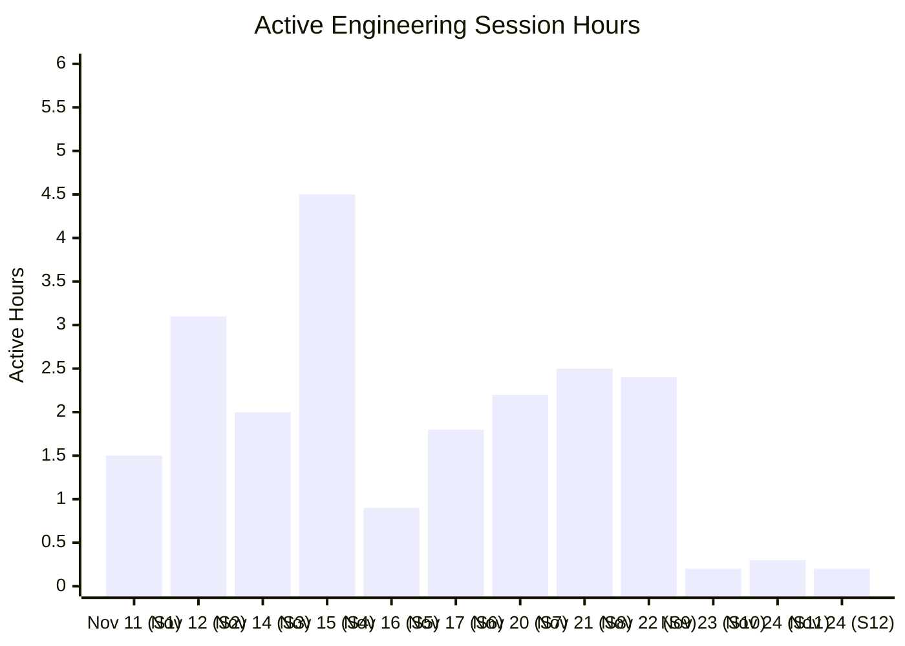
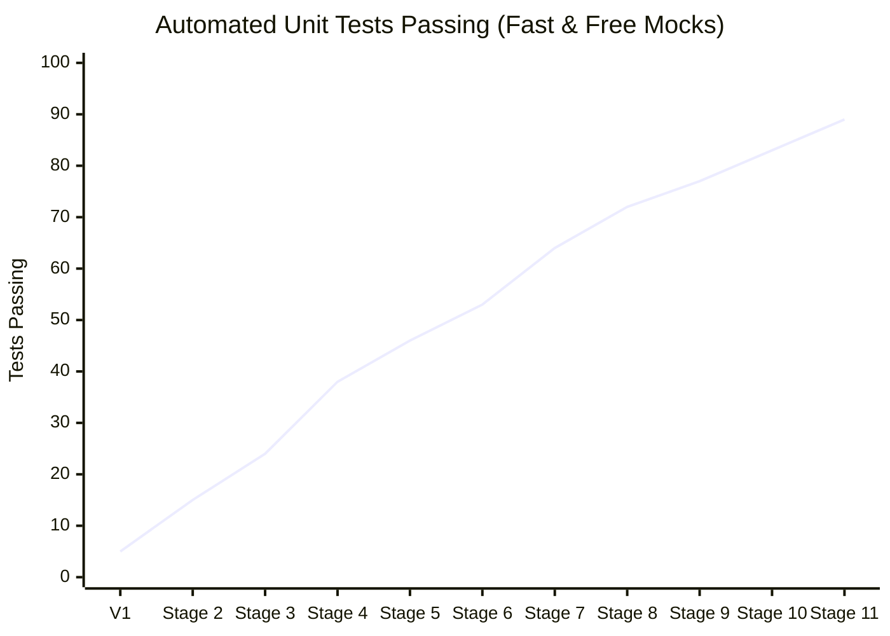
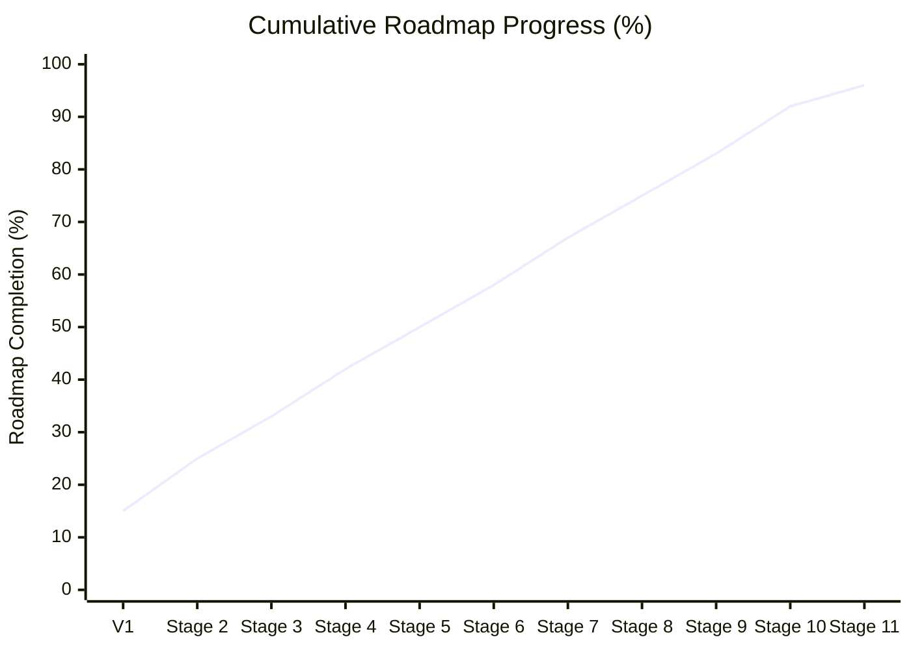

# Engineering Velocity & Session Telemetry

Tracking active engineering hours, feature delivery velocity, test suite growth, and progress toward the 12-stage Autonomous Agentic Engineer roadmap.

---

## Visual Telemetry

### 1. Active Session Hours vs Capacity

### 2. Automated Test Suite Reliability Growth

### 3. Full 12-Stage Roadmap Progress

---

## Capacity Model
- **Weekdays (Mon–Fri):** ~3 hours average target capacity per day (focused sprint on 1 feature + tests + docs).
- **Weekends (Sat–Sun):** Full-day capacity (~6–8 hours) for multi-step architecture leaps.
- **Session Boundary Rule:** 15-minute sliding inactivity window. Any message after 15+ minutes of silence begins a new session.

---

## Session History Log

### Session #12 — Nov 24, 2026 (Stage 11 Architectural Review & Commit Authorization)
- **Time Window:** Nov 24 12:44 – 12:46 IST
- **Active Duration:** **10 minutes** (0.17 hrs)
- **Session Capacity:** Weekday Afternoon Alignment
- **Planned Target:** Review Stage 11 cold email conversion principles (CTAs, mobile skim constraints), verify mock hygiene concepts, and secure commit approval.
- **Accomplished:**
  - Deconstructed Call to Action (CTA) friction mechanics and mobile reading psychology for engineering outreach.
  - Reviewed test mock isolation preventing multi-agent network leaks.
  - User confirmed commit authorization for Stage 11.
- **Scope Velocity:** **100% of planned alignment achieved**.
- **Test Suite:** **89 / 89 passing** (in ~1.05s).
- **Roadmap Completion:** **95.8%** (Stage 11 verified, Stage 12 ready to kick off).

---

### Session #11 — Nov 24, 2026 (Stage 11 Mock Isolation, Documentation & Test Velocity Leap)
- **Time Window:** Nov 24 09:00 – 09:17 IST
- **Active Duration:** **17 minutes** (0.28 hrs)
- **Session Capacity:** Weekday Morning Sprint (~2–3 hours)
- **Planned Target:** Patch unmocked `async_generate_outreach` calls in `test_agent.py`, verify instant test runtime, document Stage 11 architecture, and update progress tracking.
- **Accomplished:**
  - Patched `test_agent.py` test cases with `@patch("agent.async_generate_outreach", new_callable=AsyncMock)`.
  - Dropped full test suite runtime from **33.7s down to 1.05s** across all **89 automated unit tests** (100% passing, 0 API tokens burned).
  - Authored comprehensive technical documentation in `docs/stage11_outreach_agent.md` detailing cold outreach synthesis, low-friction CTAs, and Markdown packet persistence.
  - Updated `PROGRESS.md` advancing the 12-stage roadmap to **~95.8%**.
- **Scope Velocity:** **100% of planned Stage 11 tasks achieved**.
- **Test Suite:** **89 / 89 passing** (100% passing in ~1.05s).
- **Roadmap Completion:** **95.8%** (Stage 11 complete, Stage 12 queued).

---

### Session #10 — Nov 23, 2026 (Stage 11 Cold Outreach Integration & Mock Diagnostics)
- **Time Window:** Nov 23 21:34 – 21:42 IST
- **Active Duration:** **10 minutes** (0.17 hrs)
- **Session Capacity:** Weekday Evening Quick Check
- **Planned Target:** Review Stage 11 in-flight work, isolate unit test mock leaks in `test_agent.py`, and align test suite execution speed.
- **Accomplished:**
  - Ingested working tree state of Stage 11 Cold Outreach Agent (`outreach.py`, `test_outreach.py`, integration in `agent.py`, `batch.py`, `cli.py`).
  - Executed full test suite (89 passing). Diagnosed unmocked `async_generate_outreach` calls in 3 tests of `test_agent.py` causing 33s runtime due to live API fallback.
  - Formulated mock patch strategy to eliminate live network calls.
- **Scope Velocity:** **25% of Stage 11 session targets achieved** (interrupted overnight).
- **Test Suite:** **89 / 89 passing** (grew from 83 to 89).
- **Roadmap Completion:** **~91.7%** (Stage 11 in-flight).

---

### Session #9 — Nov 22, 2026 (Stage 10 Multi-Platform ATS & Reflection Loop Wire-Up)
- **Time Window:** Nov 22 12:52 – 21:35 IST
- **Active Duration:** **2 hours 25 minutes** (145 mins)
- **Session Capacity:** Weekend Full-Day Sprint
- **Planned Target:** Wire multi-agent reflection into agent loop, align authentic candidate resume, implement Stage 10 Lever ATS connector & unified auto-detect router, and expand test suite.
- **Accomplished:**
  - Integrated `auditor.py` reflection loop directly into `agent.py` and `batch.py` with score thresholds and audit report card persistence (Commit `507a881`).
  - Aligned candidate resume in `resume.md` with 100% authentic enterprise experience (180+ HighRadius SQL scripts, 150+ live walkthroughs, Vyuha Med Data Node.js HITL portal).
  - Built interactive Chart.js analytics dashboard in `reports/progress_dashboard.html` and markdown report artifact.
  - Implemented Stage 10 Lever REST connector (`fetch_lever_jobs`) and unified auto-probing fallback router (`fetch_live_jobs`) in `boards.py`.
  - Added 6 unit tests in `test_boards.py`. Cumulative test suite grew from 77 to **83 automated tests** (100% passing in ~1.34s).
  - Wrote technical architecture documentation in `docs/stage10_ats_connectors.md` and updated `PROGRESS.md`.
- **Scope Velocity:** **100% of planned target achieved**.
- **Test Suite:** **83 / 83 passing** (grew from 77 to 83).
- **Roadmap Completion:** **91.7%** (11/12 stages complete).

---

### Session #8 — Nov 21, 2026 (Stage 9 Interview Simulator & Client-Side Validation)
- **Time Window:** Nov 21 18:25 – 23:45 IST
- **Active Duration:** **2 hours 30 minutes** (150 mins)
- **Session Capacity:** Weekend Full-Day Sprint
- **Planned Target:** Build Stage 9 Interview Simulator Agent, implement client-side Pydantic validation to defeat 503 errors, and write unit tests.
- **Accomplished:**
  - Implemented Stage 9 `interview.py` with `InterviewBattlecard`, `InterviewQuestion`, and `STARResponse` schemas.
  - Engineered adversarial Bar Raiser prompt testing 5 dimensions (Technical Deep-Dive, System Design, Gap Defense, Client-Facing, Failure Recovery).
  - Architected client-side Pydantic validation pattern (`InterviewBattlecard.model_validate_json`) bypassing server-side grammar timeouts on deep schemas.
  - Generated live interview battlecard for Observe.AI (`applications/ObserveAI_AIAgentEngineer_Interview_Prep_20261121_183005.md`).
  - Created unit test suite `test_interview.py` (5 tests). Cumulative test suite grew from 72 to **77 automated tests** (100% passing in ~1.07s).
  - Documented in `docs/interview_simulator.md` and updated `PROGRESS.md`.
  - Conducted Stage 9 architecture quiz and initiated ground-truth resume alignment.
- **Scope Velocity:** **100% of planned target achieved**.
- **Test Suite:** **77 / 77 passing** (grew from 72 to 77).
- **Roadmap Completion:** **83.3%** (10/12 stages complete).

---

### Session #7 — Nov 19–20, 2026 (Live Application Prep & Stage 8 Multi-Agent Reflection)
- **Time Window:** Nov 19 12:05 – Nov 20 14:00 IST
- **Active Duration:** **2 hours 15 minutes** (135 mins)
- **Session Capacity:** Weekday Focused Sprint (~3 hours)
- **Planned Target:** Run live board sweep on AI startups, generate real application packets, and build Stage 8 Multi-Agent Reflection & Auditor loop.
- **Accomplished:**
  - Ran live Greenhouse board sweeps against Observe.ai using `boards.py`.
  - Generated tailored application packets in `applications/` for `AI Agent Experience Designer` (100% fit) and `AI Agent Engineer, Client Facing` (75% fit).
  - Hardened async LLM client against peak queue load: updated HTTP timeouts to 120s in `resume.py`, `extract.py`, and `generator.py`.
  - Parameterized `generator.py` and `auditor.py` with `gemini-3.1-flash-lite` for high-throughput, low-latency execution.
  - Implemented Stage 8 Multi-Agent Reflection Architecture (`auditor.py`) with `AuditCritique` Pydantic schema, adversarial technical recruiter auditor prompt, async audit agent, and bounded multi-turn reflection loop (`async_generate_audited_cover_letter`).
  - Created unit test suite `test_auditor.py` (8 tests). Cumulative test suite grew from 64 to **72 automated tests** (100% passing in ~1.21s).
  - Wrote technical architecture documentation in `docs/multi_agent_auditor.md` and updated `PROGRESS.md`.
  - Pushed Stage 8 commit `fcaeb82` to GitHub.
  - Advanced roadmap to **75.0% (9/12 stages complete)**.
- **Scope Velocity:** **100% of planned target achieved**.
- **Test Suite:** **72 / 72 passing** (grew from 64 to 72).
- **Roadmap Completion:** **75.0%** (9/12 stages complete).

---

### Session #6 — Nov 16–17, 2026 (Stage 7 Live Job Board Ingestion)
- **Time Window:** Nov 16 14:10 – Nov 17 09:20 IST
- **Active Duration:** **1 hour 45 minutes** (105 mins)
- **Session Capacity:** Weekday Focused Sprint (~2 hours)
- **Planned Target:** Stage 7 Live Greenhouse Board Ingestion & Deduplication
- **Accomplished:**
  - Implemented `boards.py` with public Greenhouse REST API client (`fetch_greenhouse_jobs`).
  - Built regex/HTML entity text sanitization pipeline (`clean_html_content`).
  - Added engineering role keyword filtering (`filter_relevant_jobs`).
  - Implemented composite-key SQLite job deduplication (`get_existing_job`) saving 100% of LLM extraction tokens on repeated sweeps.
  - Built unit test suite `test_boards.py` (10 tests). Cumulative test suite grew from 53 to **64 automated tests** (100% passing in ~1.08s).
  - Documented in `docs/job_boards.md` and pushed commit `90bd5ad`.
  - Advanced roadmap to **66.7% (8/12 stages complete)**.
- **Scope Velocity:** **100% of planned target achieved**.
- **Test Suite:** **64 / 64 passing** (grew from 53 to 64).
- **Roadmap Completion:** **66.7%** (8/12 stages complete).

---

### Session #5 — Nov 16, 2026 (Weekday Morning Sprint)
- **Time Window:** 08:33 – 09:28 IST
- **Active Duration:** **55 minutes** (0.92 hrs)
- **Session Capacity:** Weekday Morning Focused Sprint (~1 hour)
- **Planned Target:** Push Stage 5, Build Stage 6 (Batch Ingestion & Leaderboard), Test Suite Expansion, Push Stage 6
- **Accomplished:**
  - Pushed Stage 5 commit `545ba89` to GitHub.
  - Implemented Stage 6 Batch Processing engine (`batch.py`) with `scan_job_files` directory ingestion, `evaluate_batch_jobs` scoring, descending leaderboard sorting, and interactive / automated cover letter batch generation.
  - Created test jobs directory (`sample_jobs/`) with 3 realistic test postings.
  - Built unit test suite `test_batch.py` (7 tests). Cumulative test suite grew from 46 to **53 automated tests** (100% passing in ~0.64s).
  - Wrote technical architecture documentation in `docs/batch_processing.md` and updated `PROGRESS.md`.
  - Pushed Stage 6 commit `1f2b5b7` to GitHub.
  - Advanced roadmap to **58.3% (7/12 stages complete)**.
- **Scope Velocity:** **100% of planned target achieved** in a high-efficiency 55-minute sprint.
- **Test Suite:** **53 / 53 passing** (grew from 46 to 53).
- **Roadmap Completion:** **58.3%** (7/12 stages complete).

---

### Session #4 — Nov 15, 2026 (Weekend Sprint)
- **Time Window:** 09:56 – 14:15 & 21:40 – 23:00 IST
- **Active Duration:** **4 hours 35 minutes** (275 mins)
- **Session Capacity:** Weekend Sprint (~6–8 hours capacity, ~4.5h focused execution)
- **Planned Target:** Commit Stage 4, Build Agent Decision Benchmark (`eval_agent.py`), Build Interactive CLI (`cli.py`), and Architectural Line-by-Line Review
- **Accomplished:**
  - Pushed Stage 4 commit `de97668` to GitHub with content-addressable SHA-256 resume profile caching.
  - Implemented Stage 5 Agent Decision & Safety Benchmark (`eval_agent.py`) with 5 diverse scenarios. Achieved **100% decision gate accuracy** and **100% skill gap recall** in <0.01s without burning API tokens.
  - Built production Interactive Job Hunter CLI (`cli.py`) supporting multiline terminal pasting (`END`), direct file input (`-f`), custom resume paths (`-r`), and headless automation (`--non-interactive`).
  - Added unit test suite `test_cli.py` (8 tests). Cumulative test suite grew from 38 to **46 automated tests** (100% passing in ~0.71s).
  - Completed deep line-by-line architectural walkthrough of `cli.py` controller logic, `argparse` ingestion, and `interactive` Human-in-the-Loop runtime toggling.
  - Wrote technical architecture documentation in `docs/stage5_evals_cli.md` and updated `PROGRESS.md`.
  - Reached **50.0% milestone (6/12 stages)** of the 12-stage Autonomous Agentic Engineer roadmap.
- **Scope Velocity:** **100% of planned target achieved**.
- **Test Suite:** **46 / 46 passing** (grew from 38 to 46).
- **Roadmap Completion:** **50.0%** (6/12 stages complete).

---

### Session #3 — Nov 14, 2026 (Weekday Sprint)
- **Time Window:** 20:30 – 22:30 IST
- **Active Duration:** **2 hours 00 minutes** (120 mins)
- **Session Capacity:** Weekday Sprint (~3 hours)
- **Planned Target:** Stage 4 CLI Agent Loop + Candidate Profile Caching
- **Accomplished:**
  - Implemented Stage 4 hand-built autonomous CLI agent loop (`agent.py`) with `AgentState`, tool orchestration, HITL decision gates, and application packet persistence in `applications/`.
  - Built content-addressable SHA-256 candidate resume profile caching in SQLite `jobs.db` (`db.py`), bypassing Gemini on repeated runs (0ms latency, zero tokens consumed).
  - Wrote comprehensive unit tests (`test_agent.py` and `test_db.py`). Test suite grew from 24 to 38 unit tests (100% passing in ~0.38s).
  - Documented architecture and state machine in `docs/agent_loop.md` and updated `PROGRESS.md`.
- **Scope Velocity:** **100% of Stage 4 target achieved**.
- **Test Suite:** **38 / 38 passing** (grew from 24 to 38).
- **Roadmap Completion:** **41.7%** (5/12 stages complete).

---

### Session #2 — Nov 12, 2026 (Weekday)
- **Time Window:** 20:21 – 23:25 IST
- **Active Duration:** **3 hours 04 minutes** (184 mins)
- **Session Capacity:** Weekday Sprint (~3 hours)
- **Planned Target:** Stage 3 Cover Letter Generator + Stage 4 Kickoff
- **Accomplished:**
  - Diagnosed 59k corrupted PDF bytes; configured `.gitignore` for `*.pdf` and `resume.md`.
  - Ingested authentic candidate background into `resume.md`.
  - Built `generator.py` with anti-AI recruiter prompt, 10s timeout, 503 backoff, 429 fail-fast.
  - Built `test_generator.py` (5 unit tests).
  - Implemented dual-mode `POST /cover-letter` endpoint in `main.py` with `resume.md` fallback.
  - Implemented 4 integration tests in `test_main.py`.
  - Wrote `docs/cover_letter.md` and updated `PROGRESS.md`.
  - Pushed commit `2fc346f` to GitHub.
- **Scope Velocity:** **~78% of planned target achieved** (Stage 3 100% complete, Stage 4 architecture queued).
- **Test Suite:** **24 / 24 passing** (grew from 15 to 24).
- **Roadmap Completion:** **33.3%** (4/12 stages complete).

---

### Session #1 — Nov 11, 2026 (Weekday)
- **Time Window:** 20:47 – 22:20 IST
- **Active Duration:** **1 hour 33 minutes** (93 mins)
- **Planned Target:** Resume Parsing, Deterministic Matching Engine & Batch Ranking (`/match-all`).
- **Accomplished:**
  - Implemented Stage 2 core: `resume.py`, `test_resume.py`, `matcher.py`, `test_matcher.py`.
  - Implemented `POST /match` and `POST /match-all` against SQLite `jobs.db`.
  - Tested batch ranking leaderboard (<2ms in-memory execution).
- **Scope Velocity:** **100% of Stage 2 target achieved**.
- **Test Suite:** **15 / 15 passing** (grew from 5 to 15).
- **Roadmap Completion:** **25%** (3/12 stages complete).
