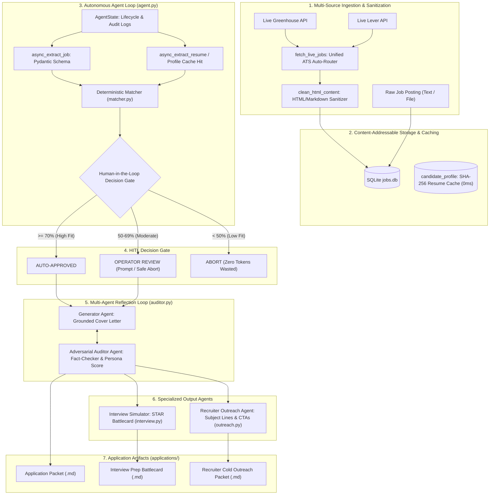

# Autonomous Job Application Agent

An enterprise-grade, end-to-end autonomous multi-agent system designed to streamline technical job hunting. It ingests messy job postings and live ATS job boards (Greenhouse & Lever), parses candidate resumes, computes deterministic skill gap alignments, enforces Human-in-the-Loop decision gates, runs multi-agent reflection loops to eliminate AI hallucinations, generates tailored interview battlecards, and drafts high-converting recruiter cold outreach packets.

Built from **first principles in pure Python** without opaque orchestration frameworks (no LangChain / CrewAI) to demonstrate resilient agent loops, state machine architectures, multi-agent reflection, and production evaluation benchmarks.

---

## 🏛️ System Architecture



---

## 🚀 Key Engineering Capabilities

1. **First-Principles Agent Loop (`agent.py`):**
   * Hand-crafted state machine (`AgentState`) tracking step transitions, execution logs, and decision rationale.
   * Zero third-party agent framework lock-in—every retry, decision gate, and tool execution is transparent and debuggable.

2. **Multi-Agent Reflection Architecture (`auditor.py`):**
   * Bounded reflection loop between a **Cover Letter Generator** and an adversarial **Technical Recruiter Auditor**.
   * Identifies ungrounded resume claims, corporate buzzwords, and factual hallucinations, prompting iterative revisions until reaching quality thresholds ($\ge 8/10$).

3. **Multi-Platform ATS Auto-Detection (`boards.py`):**
   * Live REST connectors for **Greenhouse** and **Lever**.
   * Auto-detection router probes Greenhouse and seamlessly falls back to Lever for companies like Palantir, Cloudflare, etc.
   * Deduplicates jobs in SQLite via composite keys, saving 100% of LLM extraction tokens on repeat sweeps.

4. **Deterministic Match & Gap Engine (`matcher.py`):**
   * Pure Python set operations (`&` and `-`) for instant, zero-cost, mathematical skill matching.
   * 3-layer role alignment (substring, reverse substring, and keyword token overlap).

5. **Content-Addressable Resume Profile Caching (`db.py`):**
   * Computes SHA-256 hash of `resume.md`.
   * Cache hits bypass Gemini extraction completely ($0\text{ms}$ latency, $0$ tokens consumed), auto-invalidating when resume text changes.

6. **Automated Interview Prep & Bar Raiser Simulator (`interview.py`):**
   * Generates adversarial interview battlecards across 5 core dimensions (Deep-Dive, System Design, Gap Defense, Client Walkthrough, Failure Recovery).
   * Generates grounded STAR (Situation, Task, Action, Result) defense responses from real project metrics.

7. **Recruiter Cold Outreach Agent (`outreach.py`):**
   * Generates multi-channel outreach packets: 2–3 high-converting subject lines, conversational hooks, verified proof points, `<120` word emails with low-friction CTAs, and `<75` word LinkedIn DMs.

8. **Hardened Resilience & Production Telemetry:**
   * 120s timeouts with exponential backoff on 503 service overload.
   * Immediate fail-fast without sleeping on HTTP 429 quota exhaustion.
   * Client-side Pydantic validation (`model_validate_json`) bypassing server-side grammar compilation bottlenecks.

---

## 📊 Evaluation & Verification Benchmarks

The project features a **comprehensive evaluation pyramid**:

### 1. Production End-to-End Evaluation Benchmark (`eval_e2e.py`)
Tests the entire agent lifecycle across 5 production realities (Direct Fit, Adjacent Role, Domain Mismatch, Cache Hit, Corrupt Input):
```text
===============================================================================================
                              E2E BENCHMARK SCORECARD                              
===============================================================================================
Total Scenarios Evaluated:     5
Invariants Passing:            5 / 5 (100.0%)
Gate Decision Accuracy:        100.0%
Zero-Token Guardrail Recall:   100.0%
Resilience to Corrupt Input:   100.0%
===============================================================================================
```

### 2. Automated Unit Test Suite (92 Tests in <1.0s)
100% offline, free, and fully mock-isolated:
```text
Ran 92 tests in 0.812s
OK
```

| Test Module | Tests | Scope |
| :--- | :---: | :--- |
| `test_extract.py` | 5 | Job extraction schemas, 503 backoff, 429 fail-fast |
| `test_resume.py` | 5 | Resume schemas, experience extraction, retries |
| `test_matcher.py` | 5 | Set-theory matching, gap analysis, role alignment |
| `test_generator.py` | 5 | Anti-AI prompt constraints, timeout handling |
| `test_agent.py` | 7 | State machine, decision gates, cache hit/miss |
| `test_db.py` | 11 | SQLite persistence, SHA-256 caching, deduplication |
| `test_cli.py` | 8 | Multiline console input, file ingestion, headless mode |
| `test_batch.py` | 7 | Directory scanning, leaderboard ranking, batch dispatch |
| `test_boards.py` | 16 | Greenhouse & Lever REST APIs, HTML cleaning, router |
| `test_auditor.py` | 8 | Adversarial reflection loop, critique parsing, revisions |
| `test_interview.py` | 5 | Bar Raiser battlecards, client-side Pydantic validation |
| `test_outreach.py` | 6 | Cold email synthesis, subject lines, LinkedIn DMs |
| `test_eval_e2e.py` | 3 | Full-pipeline invariant verification across scenarios |
| `test_main.py` | 1 | FastAPI integration and endpoint tests |
| **Total Passing** | **92** | **100% Passing in ~0.8s** |

---

## 💻 CLI & Interactive Usage

### 1. Interactive Job Hunter CLI
```powershell
python cli.py
```
* **Multiline terminal paste:** Paste messy postings and type `END`.
* **File input:** `python cli.py -f sample_jobs/job1.txt`
* **Headless automation:** `python cli.py -f sample_jobs/job1.txt --non-interactive`

### 2. Live Job Board Ingestion & Ranking
```powershell
# Auto-detect ATS platform (e.g. Palantir on Lever, Cloudflare on Greenhouse)
python boards.py -c palantir --limit 5
python boards.py -c cloudflare --limit 5

# Explicit platform selection
python boards.py -c observeai -p greenhouse
```

### 3. Batch Directory Ingestion & ASCII Leaderboard
```powershell
python batch.py -d sample_jobs/
```

### 4. Run End-to-End Production Evaluation
```powershell
# Fast mock benchmark (offline, 0 tokens consumed):
python eval_e2e.py

# Live benchmark against Google Gemini API:
python eval_e2e.py --live
```

### 5. Run Fast Unit Tests
```powershell
python -m unittest discover
```

---

## 📁 Repository Structure

```text
├── agent.py                 # Core autonomous CLI agent loop & state machine
├── auditor.py               # Multi-agent reflection & adversarial auditor loop
├── batch.py                 # Batch directory ingestion & ASCII leaderboard engine
├── boards.py                # Multi-platform ATS client (Greenhouse & Lever router)
├── cli.py                   # Interactive Job Hunter terminal copilot
├── db.py                    # SQLite persistence & SHA-256 resume profile caching
├── eval.py                  # Stage 1 job extraction accuracy evaluation
├── eval_agent.py            # Stage 5 decision gate benchmark
├── eval_e2e.py              # Stage 12 Capstone production end-to-end evaluation
├── extract.py               # Async Gemini job extraction logic
├── generator.py             # Grounded cover letter generation agent
├── interview.py             # Automated interview simulator & STAR battlecards
├── main.py                  # FastAPI service (/extract, /match, /match-all, /cover-letter)
├── matcher.py               # Deterministic set-theory matching & gap engine
├── outreach.py              # Recruiter cold outreach agent (emails & LinkedIn DMs)
├── resume.py                # Async Gemini resume parsing logic
├── applications/            # Generated application packets, battlecards & outreach (.md)
├── docs/                    # In-depth architectural feature documentation
│   ├── agent_loop.md
│   ├── batch_processing.md
│   ├── cover_letter.md
│   ├── interview_simulator.md
│   ├── job_boards.md
│   ├── multi_agent_auditor.md
│   ├── stage5_evals_cli.md
│   ├── stage10_ats_connectors.md
│   ├── stage11_outreach_agent.md
│   └── stage12_production_benchmark.md
├── METRICS.md               # Telemetry: session hours, test suite growth, roadmap velocity
├── PROGRESS.md              # 12-stage milestone roadmap tracking
└── README.md                # Project documentation & architecture guide
```

---

## 🛠️ Installation & Setup

1. **Clone the repository:**
   ```powershell
   git clone https://github.com/Rx4445/job-agent-.git
   cd job-agent-
   ```

2. **Set up virtual environment:**
   ```powershell
   python -m venv .venv
   .\.venv\Scripts\Activate.ps1
   pip install -r requirements.txt
   ```

3. **Configure API key:**
   ```powershell
   cp .env.example .env
   # Add your GEMINI_API_KEY to .env
   ```
