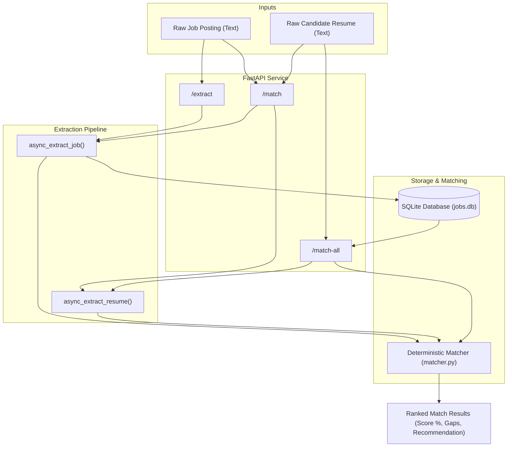

# Job Application Agent

A production-grade, async job extraction and candidate matching pipeline that converts messy, unstructured job postings and resumes into validated, structured data using Google Gemini, Pydantic, FastAPI, and SQLite.

Built from **first principles** in pure Python (without heavy orchestration frameworks like LangChain) to master resilient agent architectures, constrained decoding, deterministic matching, and automated evaluations.

---

## Architecture Overview



---

## Key Engineering Highlights

- **First-Principles Agent Loop:** Built manual retry logic with exponential backoff and jitter readiness instead of relying on opaque framework wrappers.
- **Structured Outputs (Constrained Decoding):** Enforces strict Pydantic schemas (`JobPosting`, `Resume`, `MatchResult`) at the model level via `response_mime_type="application/json"` and `response_schema`.
- **Intelligent Error Handling:**
  - **Transient Errors (503 / Timeouts):** Automatically retried with non-blocking `await asyncio.sleep(delay)`.
  - **Hard Quotas (429):** Fails fast immediately to avoid wasteful pauses when daily limits are reached.
  - **Zombie Call Prevention:** 10-second request timeout configured via `google.genai.types.HttpOptions(timeout=10000)`.
- **Deterministic Match & Gap Engine:** 
  - Pure Python set operations (`&` for matching skills, `-` for skill gaps).
  - 3-layer role alignment (substring, reverse substring, keyword overlap).
  - Case-insensitive comparison with original casing preserved for presentation.
- **Batch Leaderboard Ranking (`/match-all`):** Parses resume once and instantly ranks all stored SQLite jobs by match percentage in pure Python (<2ms).
- **SQL Injection Safe Storage:** SQLite persistence using parameterized queries and JSON serialization for skill lists.
- **Automated 10-Case Evaluation Harness:** Includes a dedicated benchmark (`eval.py` + `eval_postings.json`) testing accuracy across messy, edge-case job postings with rate-limit pacing.

---

## API Endpoints

| Method | Endpoint | Description |
| :--- | :--- | :--- |
| `POST` | `/extract` | Ingests raw job posting text, extracts structured JSON, and saves to SQLite |
| `POST` | `/match` | Ingests job posting + candidate resume, extracts both, and returns detailed match score and skill gaps |
| `POST` | `/match-all` | Ingests candidate resume and returns a ranked leaderboard of all stored SQLite jobs from best to worst fit |

---

## Evaluation Benchmark

Tested across 10 realistic job postings (varying lengths, missing companies, and implied vs required skills):

| Metric | Score | Performance |
| :--- | :--- | :--- |
| **Title Accuracy** | 10 / 10 | **100%** |
| **Company Accuracy** | 10 / 10 | **100%** (normalized) |
| **Skills Accuracy** | 7 / 10 raw | Captures high-value context including nice-to-have & soft skills |

---

## Getting Started

### 1. Clone & Set Up Virtual Environment
```powershell
git clone https://github.com/Rx4445/job-agent-.git
cd job-agent-

python -m venv .venv
.venv\Scripts\Activate.ps1
pip install -r requirements.txt
```

### 2. Configure Environment Variables
Copy `.env.example` to `.env` and insert your Gemini API key:
```powershell
cp .env.example .env
```
Edit `.env`:
```env
GEMINI_API_KEY=your_gemini_api_key_here
```

### 3. Run the API Server
```powershell
uvicorn main:app --reload
```
The server will start at `http://127.0.0.1:8000`. You can test endpoints interactively via Swagger UI at `http://127.0.0.1:8000/docs`.

---

## Running Tests & Evaluations

### Run Unit Tests (Fast & Free)
All 15 unit tests mock external API calls and time delays, running in ~0.1s:
```powershell
python -m unittest
```

### Run Model Evaluation
Runs live extractions against the 10-case evaluation set:
```powershell
python eval.py
```

---

## Project Structure

```text
├── main.py              # FastAPI application, endpoints (/extract, /match, /match-all)
├── extract.py           # Gemini job extraction logic, Pydantic schema & retry loop
├── resume.py            # Gemini resume extraction logic & Candidate schema
├── matcher.py           # Deterministic matching & gap analysis engine
├── db.py                # SQLite database connection, table initialization & queries
├── eval.py              # Evaluation script scoring extraction accuracy
├── eval_postings.json   # 10 ground-truth test cases for model evaluation
├── test_main.py         # Unit tests for the FastAPI API endpoints
├── test_extract.py      # Async unit tests for job extraction retry loop
├── test_resume.py       # Async unit tests for resume extraction retry loop
├── test_matcher.py      # Unit tests for matching engine edge cases
├── docs/                # Feature documentation & design decisions
│   ├── retry_loop.md    # Architecture of manual retry & error handling
│   ├── evals.md         # Evaluation harness & baseline documentation
│   └── matcher.md       # Matching methodology & set theory documentation
├── requirements.txt     # Python project dependencies
├── .env.example         # Template for environment variables
└── PROGRESS.md          # Project roadmap tracking
```
