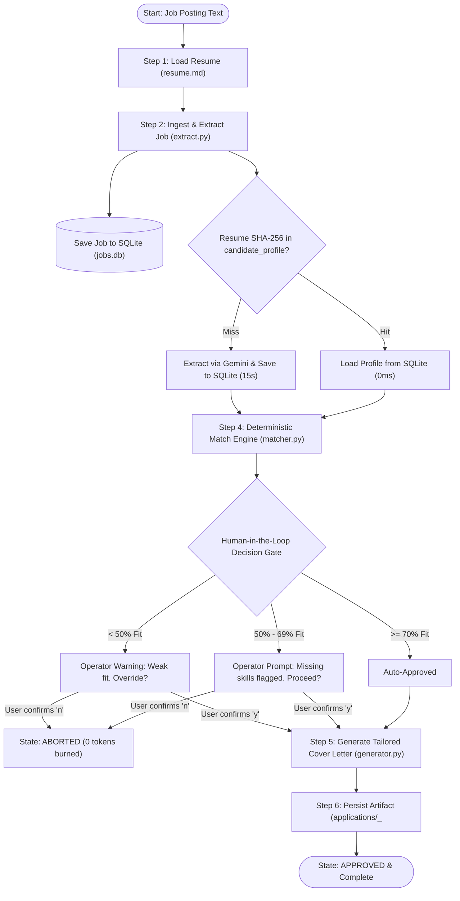

# Stage 4: Autonomous CLI Agent Loop (`agent.py`)

## Overview
The Autonomous CLI Agent Loop transitions our system from a collection of isolated API endpoints into an end-to-end, multi-step autonomous agent. Built **by hand in pure Python** (without LangChain, CrewAI, or AutoGen), it manages state, coordinates tool invocation, enforces Human-in-the-Loop (HITL) decision gates, and produces audit-trailed application artifacts.

---

## Architecture & State Machine



---

## Core Engineering Components

### 1. The `AgentState` Dataclass
Rather than passing loose function arguments between steps, the agent operates on a unified state container:
- `posting_text`: Raw incoming job text
- `resume_text`: Loaded plain text markdown resume
- `job`: Extracted `JobPosting` object
- `candidate`: Extracted `Resume` profile
- `match`: Deterministic `MatchResult` (score %, matched skills, gaps)
- `decision`: Current state (`PENDING`, `APPROVED`, `ABORTED`)
- `cover_letter`: Generated Markdown cover letter
- `output_path`: Filepath to the saved application packet
- `logs`: Audit log of each step with timestamps (`HH:MM:SS`)

### 2. Human-in-the-Loop (HITL) Gating
An autonomous agent must not blindly spend money or tokens on bad targets. The decision gate introduces dynamic agency:
- **High Fit ($\ge 70\%$):** High confidence. Proceeds autonomously.
- **Moderate Fit ($50\% - 69\%$):** Flags specific gaps to the operator before generating.
- **Weak Fit ($< 50\%$):** Strongly advises against applying to protect candidate time and avoid token waste.

### 3. Candidate Profile SHA-256 Caching
To eliminate redundant LLM calls on every run, the agent uses content-addressable caching:
- Hashes `resume.md` using SHA-256 (`compute_resume_hash`).
- If the hash matches an entry in SQLite table `candidate_profile`, deserializes and loads in **0ms** without touching Gemini.
- If the resume text is edited or missing from cache, extracts via Gemini once and persists to SQLite.

### 4. Application Artifact Generation
When approved, the agent saves a persistent Markdown document to `applications/` containing:
- Executive summary (Company, Role, Match %, Recommendation)
- Detailed skill alignment (matched skills vs gaps)
- Complete tailored cover letter
- Execution audit log with timestamps

*(Note: `applications/` is included in `.gitignore` to protect personal application materials from public version control).*

---

## Verification & Testing

Run the agent unit test suite:
```powershell
python -m unittest test_agent.py
```
- Tests auto-approval on high match
- Tests human-in-the-loop approval on moderate match
- Tests human-in-the-loop abortion on moderate match (verifying generation is never called)
- Tests warning and abort on low match
- Tests graceful failure on missing resume file
- Tests resume cache hit (skips LLM extraction completely)
- Tests resume cache miss (calls Gemini and persists to SQLite)

Run the database unit test suite:
```powershell
python -m unittest test_db.py
```
- Tests deterministic SHA-256 hash generation
- Tests candidate profile cache miss returning `None`
- Tests candidate profile saving and retrieval
- Tests candidate profile conflict replacement (upsert)
- Tests job saving and retrieval

Run the complete project test suite:
```powershell
python -m unittest discover
```
- **38 unit tests passing** across 6 modules in ~0.38 seconds.
