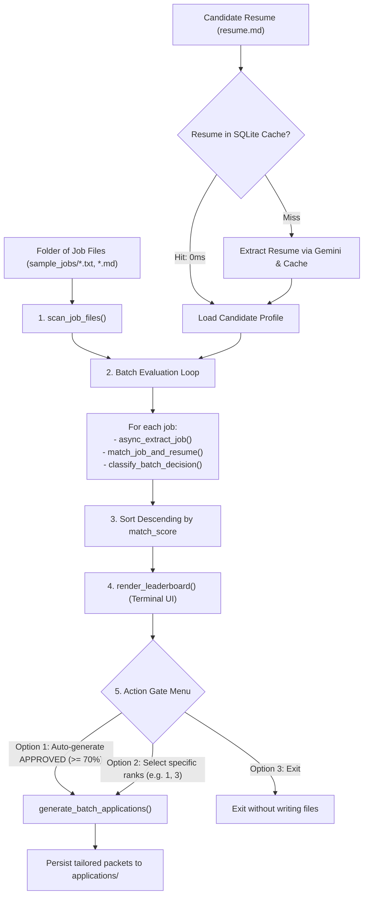

# Stage 6: Batch Job Ingestion & Leaderboard Ranking (`batch.py`)

## Overview
Stage 6 scales the agent from a single-job CLI tool into a multi-job batch processor. Instead of evaluating jobs one at a time, the agent scans a directory of job postings, scores and ranks them against the candidate's resume, presents an ASCII Leaderboard, and auto-dispatches tailored applications.

---

## Architecture Flow



---

## Key Engineering Components

### 1. Robust File Scanner (`scan_job_files`)
- Traverses a directory and ingests all `.txt` and `.md` files.
- Ignores unsupported files (images, PDFs, system files).
- Alphabetically sorts filenames for deterministic, reproducible evaluation order.

### 2. Candidate Cache Integration
- Reuses the Stage 4 content-addressable SHA-256 fingerprinting mechanism.
- Loads the candidate profile in **0ms** from SQLite (`jobs.db`) rather than re-extracting for every job in the batch.

### 3. Leaderboard Terminal Renderer (`render_leaderboard`)
- Dynamically formats a fixed-width ASCII table with:
  - **Rank:** Numeric rank (1, 2, 3...)
  - **Score:** Match percentage (e.g. `85.7%`)
  - **Decision:** Auto-classification (`APPROVED`, `REVIEW`, `ABORTED`)
  - **Company & Role:** Extracted target information
  - **Missing Gaps:** Up to 3 top required skills the candidate lacks

### 4. Interactive & Headless Dispatching
- **Interactive Mode:** Allows the operator to review the leaderboard before choosing whether to generate applications for all approved roles or select specific candidates.
- **Headless Mode (`auto_generate_approved=True`):** Designed for scheduled cron jobs or scripts to process folders and output applications automatically.

---

## Verification & Testing

Run the batch test suite:
```powershell
python -m unittest test_batch.py
```
- Tests directory filtering and alphabetical ordering
- Tests missing directory error handling
- Tests decision classification thresholds (70% / 50%)
- Tests descending leaderboard sorting
- Tests batch application packet persistence
- Tests headless auto-generation filtering

Run the full project test suite:
```powershell
python -m unittest discover
```
- **53 unit tests passing** across 8 modules in ~0.64 seconds.
