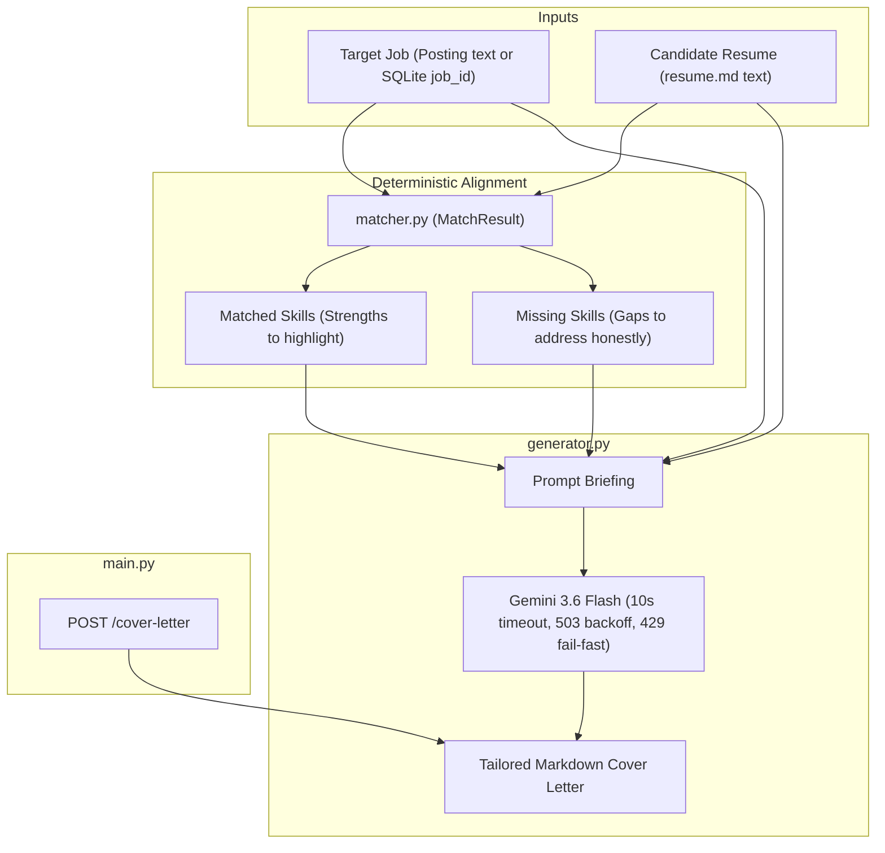

# Stage 3: Tailored Cover Letter Generator

## Overview
The Stage 3 Cover Letter Generator drafts highly tailored, metric-driven applications grounded strictly in the candidate's actual resume. Rather than producing generic, buzzword-heavy AI letters, it operates on a "direct briefing" architecture: combining deterministic match results from Stage 2 with uncompressed Markdown resume context.

---

## Architectural Workflow



---

## Engineering Decisions

1. **Direct Briefing (Avoiding Lossy Compression):**
   - Instead of compressing rich project bullet points into rigid intermediate JSON schemas (which strips fine-grained numbers and narrative nuance), the full Markdown text of `resume.md` is fed directly to the generation model alongside structured matching directives.
2. **Anti-AI Persona & Strict Grounding:**
   - **Persona:** Experienced technical recruiter who rejects generic ChatGPT clichés (*"thrilled to apply"*, *"dynamic synergy"*, *"testament to my passion"*).
   - **Grounding Rule:** The model is forbidden from inventing tools, metrics, or roles not present in the candidate resume.
   - **Grounded Proof Points:** The prompt instructs the model to pull the specific project from the resume that demonstrates each matched skill.
   - **Gap Honesty:** Missing skills are framed honestly through adjacent tools and learning agility rather than fabricated experience.
3. **Dual-Mode API (`POST /cover-letter`):**
   - **Raw Posting Mode:** Ingests a new job description, extracts structured data, saves it to SQLite, and generates the letter.
   - **Saved Job Mode (`job_id`):** Fetches an already-extracted job directly from SQLite (`jobs.db`) to eliminate redundant extraction calls.
   - **Automatic `resume.md` Fallback:** If `resume` is empty, it automatically reads the local `resume.md` file.

---

## Error Handling & Resilience
- **Timeouts:** 10,000ms request timeout via `types.HttpOptions(timeout=10000)`.
- **Transient Failures (503):** 3-attempt exponential backoff loop (`asyncio.sleep(2 ** attempt)`).
- **Hard Quotas (429):** Fails fast immediately to avoid hanging or wasting sleep cycles when daily quotas are hit.

---

## Verification & Testing

Run the full unit test suite:
```powershell
python -m unittest discover
```
- Total tests: 24 tests across `test_extract.py`, `test_resume.py`, `test_matcher.py`, `test_generator.py`, and `test_main.py`.
- Execution time: ~0.12s (all external API calls and time delays mocked).
