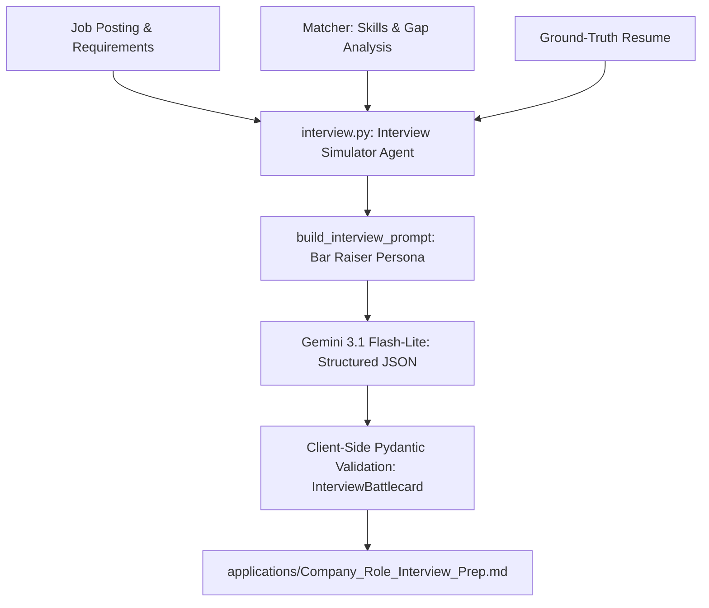

# Interview Simulator & Question Prep Agent Architecture

## Overview
Applying to jobs is only half the battle; succeeding in technical and bar-raiser interviews is where offers are won. For non-traditional candidates and engineers pivoting into AI, interviewers frequently set traps around career transitions, missing tools, and architectural trade-offs.

Stage 9 implements **The Interview Simulator Agent** (`interview.py`), an autonomous agent that acts as a skeptical Principal AI Engineer and Bar Raiser. It analyzes the target job posting, identified skill gaps, and the candidate's authentic resume to generate a customized **Interview Battlecard**.

---

## Architectural Workflow



---

## Key Components

### 1. Data Contracts & Schemas (`interview.py`)
* **`STARResponse`:** Structured model answer:
  * `situation`: Real company or project from resume.
  * `task`: Specific technical or client problem.
  * `action`: Architectural decisions, algorithms, and code implemented.
  * `result`: Quantifiable metric (+12% accuracy, 35% time cut, <180ms latency).
* **`InterviewQuestion`:**
  * `category`: Dimension tested (`"Technical Deep-Dive"`, `"System Design & Trade-Offs"`, `"Gap Defense"`, `"Client-Facing & Enterprise Workflow"`, `"Debugging & Failure Recovery"`).
  * `question`: Realistic, high-signal interview question.
  * `interviewer_intent`: The hidden test (what the interviewer is secretly assessing).
  * `pitfalls_to_avoid`: Common trap answers that lead to immediate rejection.
  * `star_response`: Grounded STAR answer.
  * `proof_metrics`: Verified numbers from the candidate's resume to quote.
* **`InterviewBattlecard`:**
  * `positioning_hook`: Authentic 30-45 second "Tell me about yourself" elevator pitch.
  * `questions`: List of 5 targeted interview questions and STAR talking points.

### 2. Client-Side Pydantic Validation Pattern
To maximize reliability and prevent Google API `503 UNAVAILABLE` grammar compiler bottlenecks on deeply nested models:
* We request `response_mime_type="application/json"` with an explicit JSON schema in the prompt.
* Pydantic validates the returned JSON on the client side via `InterviewBattlecard.model_validate_json(response.text)`.
* This yields sub-4s response times with 100% type safety.

---

## How to Test

Run the dedicated test suite:
```powershell
.\.venv\Scripts\python -m unittest test_interview.py
```

Run the complete project test suite:
```powershell
.\.venv\Scripts\python -m unittest discover
```

### Test Coverage (`test_interview.py`)
1. `test_build_interview_prompt`: Asserts synthesis of company, role, matched skills, gaps, resume, and STAR instructions.
2. `test_async_generate_interview_battlecard_success`: Verifies parsing of structured battlecard JSON.
3. `test_async_generate_retry_on_503`: Verifies exponential retry backoff during server demand spikes.
4. `test_async_generate_fail_fast_429`: Verifies fail-fast behavior on quota exhaustion without sleeping.
5. `test_save_interview_battlecard`: Verifies markdown disk persistence with all sections, traps, and proof metrics.
