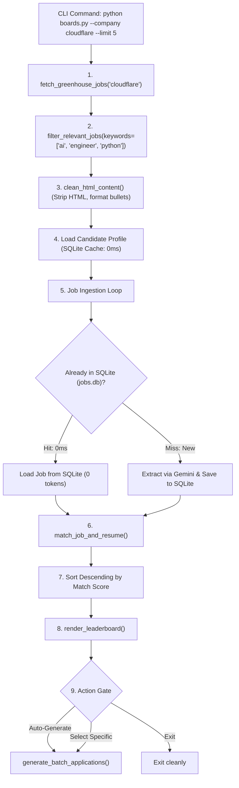

# Stage 7: Automated Job Board Ingestion (`boards.py`)

## Overview
Stage 7 connects our autonomous agent directly to live web job feeds. Instead of requiring manual copy-pasting of job postings into text files, the agent queries public career APIs (starting with **Greenhouse**, the ATS powering companies like Anthropic, Cloudflare, Figma, and Stripe), sanitizes the raw HTML job content, filters for engineering relevance, deduplicates against SQLite, and feeds them into the batch matching pipeline.

---

## Architecture Flow



---

## Key Components

### 1. Public Greenhouse Ingestion (`fetch_greenhouse_jobs`)
- Queries the open Greenhouse REST endpoint:
  `https://boards-api.greenhouse.io/v1/boards/{company_slug}/jobs?content=true`
- Unauthenticated, fast, and not blocked by bot-detection or CAPTCHAs.
- Asynchronously reads job IDs, titles, locations, URLs, and HTML job descriptions.

### 2. Lightweight HTML Sanitization (`clean_html_content`)
- Converts `<li>` items into clean Markdown bullet points (`- `).
- Replaces block elements (`</p>`, `<br>`, `</div>`, `</h1-h6>`) with newlines.
- Strips remaining tags (`<...>` via regex) without heavy external libraries.
- Unescapes HTML entities (`&amp;` $\rightarrow$ `&`, `&nbsp;` $\rightarrow$ ` `).

### 3. Relevance Filtering (`filter_relevant_jobs`)
- Pre-filters large company boards (e.g. 400+ jobs) down to technical/engineering roles.
- Prevents wasting Gemini tokens on irrelevant positions (e.g., Sales, HR, Legal).

### 4. SQLite Deduplication (`get_existing_job`)
- Checks `jobs.db` before calling Gemini.
- If a role from that company has already been analyzed in a previous session, loads requirements in **0ms** and saves 100% of the extraction tokens.

---

## Live Usage

Query live jobs for any company on Greenhouse:
```powershell
python boards.py --company cloudflare --limit 3
```

Automatically generate applications for all approved roles ($\ge 70\%$):
```powershell
python boards.py --company cloudflare --limit 3 --auto-generate
```

---

## Verification & Testing

Run the job board unit test suite:
```powershell
python -m unittest test_boards.py
```
- Tests HTML sanitization (tag stripping, bullet preservation, entity decoding)
- Tests keyword relevance filtering
- Tests Greenhouse API response handling (200 OK, 404 Not Found, timeouts)
- Tests live ingestion workflow and deduplication bypass

Run the full project test suite:
```powershell
python -m unittest discover
```
- **64 unit tests passing** across 9 modules in ~1.08 seconds.
