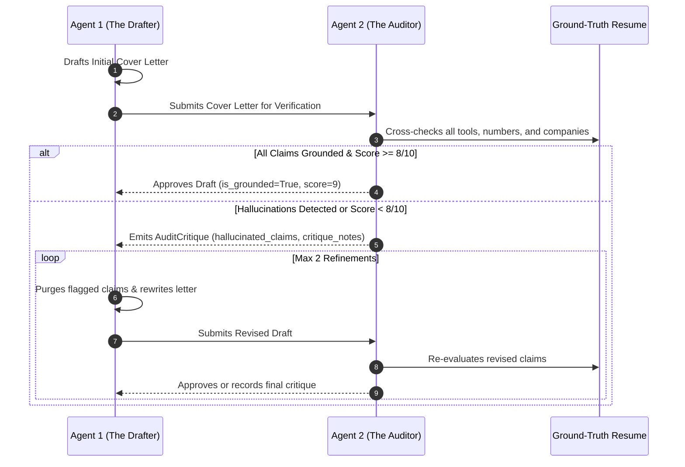

# Multi-Agent Reflection Architecture: Drafter & Auditor Loop

## Overview
In single-agent generative pipelines, large language models suffer from the **Generation Blind Spot**: when prompted to be persuasive and match complex job requirements, models frequently engage in *optimistic extrapolation* or *hallucination drift* (e.g., claiming to have deployed Kubernetes clusters or led 15 engineers when the source resume only mentions Docker and solo technical execution).

Stage 8 eliminates single-pass hallucinations by implementing a hand-built **Multi-Agent Reflection Pattern** in pure Python. The architecture decouples generation from critique by introducing a specialized, adversarial **Auditor Agent** that fact-checks the drafted letter against ground-truth resume facts and drives bounded, iterative refinement.

---

## Architectural Workflow



---

## Key Components

### 1. Structured Critique Schema (`AuditCritique`)
The Auditor does not output freeform text; it returns a strict Pydantic model:
* `score: int` — Rating from 1 to 10.
* `is_grounded: bool` — Strict boolean flag. `False` if even a single metric or tool is unverified.
* `hallucinated_claims: list[str]` — Explicit list of ungrounded statements flagged for purging.
* `tone_rating: str` — Categorical assessment (`"authentic"`, `"too_robotic"`, `"too_aggressive"`).
* `critique_notes: str` — Concrete, actionable instructions passed back to the Drafter.

### 2. Specialized Agent Personas
* **Agent 1 (The Drafter):** Ambitious, peer-to-peer software engineer pitching their authentic projects, highlighting metrics, and bridging past problems to the company's stack.
* **Agent 2 (The Auditor):** Cynical, skeptical Engineering Hiring Manager and Fact-Checker. Any hallucination automatically caps the maximum possible score to $\le 5/10$.

### 3. Bounded Reflection Loop (`async_generate_audited_cover_letter`)
* **Termination Rule 1 (Early Exit):** If `is_grounded and score >= pass_score (8)`, the loop terminates on turn 0.
* **Termination Rule 2 (Bounded Iterations):** Limited to `max_refinements=2` to guarantee deterministic runtime and prevent runaway token consumption.

---

## How to Test

Run the dedicated test suite:
```powershell
.\.venv\Scripts\python -m unittest test_auditor.py
```

Run the complete project test suite:
```powershell
.\.venv\Scripts\python -m unittest discover
```

### Test Coverage Highlights (`test_auditor.py`)
1. `test_build_auditor_prompt`: Verifies prompt synthesis with ground-truth resume and job context.
2. `test_build_revision_prompt`: Confirms hallucinated claims are formatted into explicit PURGE instructions.
3. `test_async_audit_cover_letter_success`: Verifies structured parsing of an approved audit.
4. `test_async_audit_cover_letter_catches_hallucination`: Tests adversarial detection of invented claims.
5. `test_async_audit_retry_on_503`: Verifies exponential backoff during server load spikes.
6. `test_reflection_loop_approves_on_first_try`: Validates turn-0 early exit on clean drafts.
7. `test_reflection_loop_refines_flawed_draft`: Validates multi-turn reflection: Draft 1 fails $\rightarrow$ purged $\rightarrow$ Draft 2 approved.
8. `test_reflection_loop_respects_max_refinements`: Verifies loop terminates at bound without recursion.
