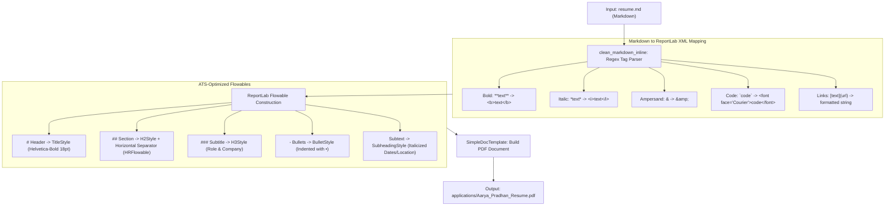

# Resume PDF Generator Architecture

## Overview
While the agent stores and refines the candidate's ground truth experience in Markdown (`resume.md`), modern Applicant Tracking Systems (ATS) like Greenhouse, Lever, and Workday require binary PDF documents for job applications.

The **Resume PDF Generator** (`pdf_generator.py`) compiles unstructured or structured Markdown resumes into clean, professionally formatted, single/two-page ATS-optimized PDFs.

---

## Architectural Workflow



---

## Key ATS-Compliance Rules

1. **Strict Single-Column Flow:**
   * Many modern ATS parsers fail when reading multi-column sidebars, table grids, or floating text frames, resulting in scrambled chronological order.
   * `pdf_generator.py` uses a linear single-column flow that standard ATS text extractors read cleanly from top to bottom.

2. **Standard Vector Typography:**
   * Uses built-in `Helvetica` and `Helvetica-Bold` fonts. These do not require embedded custom fonts, ensuring universally parseable ASCII/Unicode text streams.

3. **High-Contrast, Distraction-Free Palette:**
   * Text colors: Deep Slate (`#0F172A`, `#1E293B`) on pure white (`#FFFFFF`).
   * Subtle dividers: `#CBD5E1` horizontal rules separating sections.

4. **Zero Compromise Security:**
   * Output `.pdf` files are protected by `.gitignore` rules (`*.pdf` and `applications/`) so personal contact details and phone numbers are never committed to public repositories.

---

## How to Test

Run the dedicated PDF generator unit test suite (4 tests):
```powershell
python -m unittest test_pdf_generator.py
```

Run the entire project test suite (96 tests passing in ~1.0s):
```powershell
python -m unittest discover
```

Generate a fresh resume PDF directly from terminal:
```powershell
python pdf_generator.py
```
