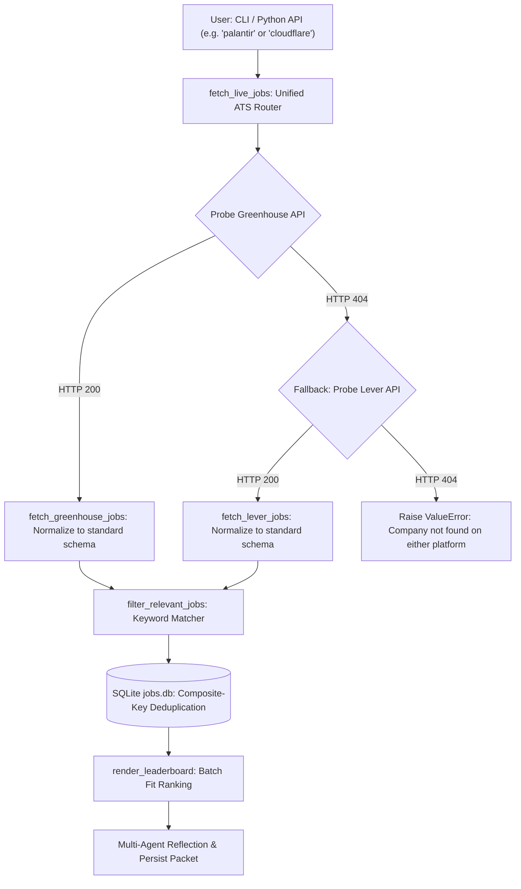

# Stage 10: Multi-Platform ATS Expansion Architecture

## Overview
Automated job hunting requires wide market coverage. In Stage 7, we built the Greenhouse API ingestion client. However, top enterprise and AI engineering companies (including Palantir, the pioneer of the Forward Deployed Engineer role) use **Lever** as their Applicant Tracking System (ATS).

Stage 10 implements **Multi-Platform ATS Connectors** with a **Unified Auto-Detection Router** in `boards.py`. Users can query any company slug without knowing whether they use Greenhouse or Lever—the agent automatically probes and routes requests to the correct platform.

---

## Architectural Workflow



---

## Key Components

### 1. Lever REST API Client (`fetch_lever_jobs`)
* **Endpoint:** `GET https://api.lever.co/v0/postings/{company_slug}?mode=json`
* **Schema Normalization:**
  * Title: Extracted from `j["text"]`.
  * Location: Extracted from `j["categories"]["location"]`.
  * Content Aggregation: Combines `descriptionPlain` + structured bullet lists from `j["lists"]` (cleaned via `clean_html_content`) + `additionalPlain`.
  * URL: Direct application link from `j["hostedUrl"]`.

### 2. Unified Auto-Detection Router (`fetch_live_jobs`)
* Supports `platform="greenhouse"`, `platform="lever"`, or `platform="auto"` (default).
* In `auto` mode:
  1. Probes Greenhouse first.
  2. If Greenhouse returns 404 (or fails), seamlessly falls back to Lever.
  3. Returns a tuple: `(parsed_jobs, detected_platform)`.
  4. If neither platform finds the company, raises a clear `ValueError`.

### 3. CLI Command-Line Arguments
```powershell
# Auto-detect ATS platform (e.g. Palantir on Lever)
python boards.py -c palantir --limit 3

# Explicit platform selection
python boards.py -c cloudflare -p greenhouse
python boards.py -c palantir -p lever
```

---

## How to Test

Run the dedicated job boards test suite (16 tests):
```powershell
.\.venv\Scripts\python -m unittest test_boards.py
```

Run the entire project test suite (83 tests):
```powershell
.\.venv\Scripts\python -m unittest discover
```

### Test Coverage (`test_boards.py`):
1. `test_fetch_lever_jobs_success`: Verifies JSON parsing of Lever jobs, text normalization, and list extraction.
2. `test_fetch_lever_jobs_not_found_404`: Verifies clean `ValueError` handling for non-existent companies.
3. `test_fetch_lever_jobs_network_timeout`: Verifies `ConnectionError` handling on network timeouts.
4. `test_fetch_live_jobs_explicit_platforms`: Asserts explicit routing to Greenhouse or Lever.
5. `test_fetch_live_jobs_auto_fallback_to_lever`: Asserts seamless fallback to Lever when Greenhouse 404s.
6. `test_fetch_live_jobs_auto_both_fail_raises_value_error`: Asserts dual-platform 404 raises descriptive error.
