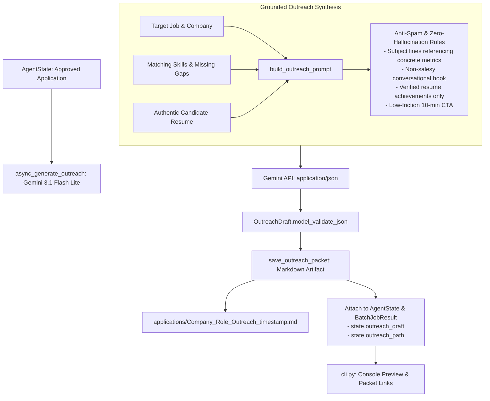

# Stage 11: Real-time Recruiter Cold Outreach Agent Architecture

## Overview
Applying to high-demand AI and engineering roles through job board portals alone often leads to applicant tracking system (ATS) black holes. High-conversion job seekers pair every tailored application with direct, multi-channel outreach to engineering hiring managers and technical recruiters.

Stage 11 introduces the **Recruiter Cold Outreach Agent** (`outreach.py`). It synthesizes the candidate's authentic resume data, the job posting requirements, and the deterministic match results into a high-converting, multi-channel cold outreach packet:
1. **High-Open-Rate Subject Lines:** 2–3 curiosity-driven, metric-focused subject lines.
2. **Conversational Hook:** Opening sentence anchored in what the company is actually building (purging generic phrases like *"I hope this email finds you well"*).
3. **Quantitative Proof Points:** 1–2 verified metrics directly grounded in candidate history (e.g., 180+ SQL migrations, 150+ enterprise walkthroughs).
4. **Short Cold Email Body (<120 words):** Concise value proposition with a low-friction call to action (e.g., *"open to a 10-minute chat this Thursday?"*).
5. **LinkedIn InMail / DM (<75 words):** Ultra-concise direct message tailored for LinkedIn character limits and mobile reading.

---

## Architectural Workflow



---

## Key Components

### 1. Structured Outreach Schema (`OutreachDraft`)
Defined in `outreach.py` using Pydantic:
* `company`: Target organization name.
* `role`: Target job title.
* `subject_lines`: List of 2–3 high-converting email subject lines.
* `hook`: Single conversational opener referencing company initiatives.
* `proof_points`: 1–2 bullet points highlighting real quantitative achievements.
* `email_body`: Polished email under 120 words with low-friction CTA.
* `linkedin_dm`: Condensed message under 75 words for direct messaging.

### 2. Client-Side Validation & Resilience
To prevent grammar compilation bottlenecks and 503 errors on deep schemas:
* Uses `response_mime_type="application/json"` with 120s HTTP timeout.
* Validates client-side via `OutreachDraft.model_validate_json(response.text)`.
* Exponential backoff (`2 * 2^attempt`) on 503 service overload.
* Immediate fail-fast without sleeping on HTTP 429 quota exhaustion.

### 3. Packet Disk Persistence (`save_outreach_packet`)
Outputs a standalone Markdown packet in `applications/` alongside the cover letter and interview battlecard:
```text
applications/
├── ObserveAI_AIAgentEngineer_20261124_091427.md          (Application Packet)
├── ObserveAI_AIAgentEngineer_Outreach_20261124_091427.md (Cold Outreach Packet)
└── ObserveAI_AIAgentEngineer_Interview_Prep_...md        (Interview Battlecard)
```

### 4. End-to-End Orchestration Integration
* **`agent.py`:** Runs as Step 5/5 immediately after the cover letter reflection loop, writing recruiter outreach metadata directly into the summary header of the application packet.
* **`batch.py`:** Automatically drafts outreach packets for every approved job in batch ingestion sweeps.
* **`cli.py`:** Displays an instant terminal preview of the recommended subject line and email body upon application approval.

---

## How to Test

Run the dedicated outreach test suite (6 tests):
```powershell
python -m unittest test_outreach.py
```

Run the complete project test suite (89 tests in ~1.0s):
```powershell
python -m unittest discover
```
