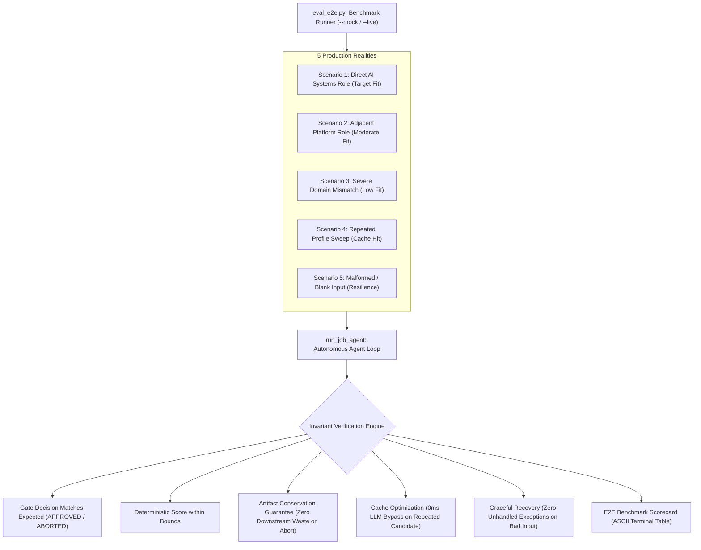

# Stage 12: Production End-to-End Evaluation Benchmark & System Capstone

## Overview
The capstone achievement of an **Agentic AI Engineer** is verifying that an autonomous multi-agent system operates predictably, safely, and cost-effectively in production without constant human supervision. 

While isolated unit tests verify individual functions, **Stage 12 introduces the End-to-End Evaluation Benchmark (`eval_e2e.py`)**. It exercises the full agentic loop (`agent.py`)—spanning resume ingestion, SHA-256 caching, job extraction, deterministic gap matching, Human-in-the-Loop decision gates, multi-agent reflection auditing, cold outreach drafting, and disk persistence—across a matrix of real-world job-seeking scenarios.

---

## Architectural Workflow



---

## Benchmark Scenario Matrix

| Scenario | Candidate Profile | Target Posting | Expected Gate | Artifact Guarantee | Primary Production Risk Tested |
| :--- | :--- | :--- | :--- | :--- | :--- |
| **1. Direct Target Fit** | AI Systems Engineer (2y exp, RAG, Vector DBs, Kubernetes) | AI Systems Engineer at Nexus AI | **APPROVED** ($\ge 70\%$) | Full Packet + Cover Letter + Outreach | Multi-agent synthesis & end-to-end file persistence |
| **2. Adjacent Role** | AI Systems Engineer | Backend Platform Engineer at CloudScale (Go, AWS, Docker) | **ABORTED** ($50-69\%$) | **No files written** | Guardrail safety: prevents auto-applying to ambiguous roles in headless mode |
| **3. Severe Mismatch** | AI Systems Engineer | Senior Graphic Designer at CreativeStudio | **ABORTED** ($0-49\%$) | **Zero generation tokens** | Cost control: immediately aborts without calling generation LLMs |
| **4. Profile Cache Hit** | Identical Resume SHA-256 Hash | AI Engineer at InnoTech | **APPROVED** ($100\%$) | Full Packet (0ms candidate extraction) | Content-addressable SQLite cache bypass integrity |
| **5. Corrupt Input** | Standard Resume | Whitespace / Blank text (`\n \t`) | **ABORTED** ($0\%$) | Non-crashing graceful exit | System resilience against malformed web scrapes or network corruption |

---

## Benchmark Results (Pass Rate: 100%)

Running the benchmark via `python eval_e2e.py`:

```text
===============================================================================================
      PRODUCTION END-TO-END EVALUATION BENCHMARK (STAGE 12 CAPSTONE)      
      Execution Mode: FAST MOCK (Offline, 0 Tokens)      
===============================================================================================

[1/5] Target AI Systems Role (Auto-Approve & Full Artifacts)
    Status:        [PASS] (Score: 100.0%, Latency: 9.0ms)
    Decision:      Actual: APPROVED | Expected: APPROVED
    Artifacts:     Cover Letter: True | Outreach: True | Packet: True
    Diagnostics:   All invariants passed perfectly

[2/5] Adjacent Backend Role (Moderate Fit -> Safe Headless Abort)
    Status:        [PASS] (Score: 50.0%, Latency: 1.4ms)
    Decision:      Actual: ABORTED | Expected: ABORTED
    Artifacts:     Cover Letter: False | Outreach: False | Packet: False
    Diagnostics:   All invariants passed perfectly

[3/5] Severe Domain Mismatch (Low Fit -> Immediate Guardrail Abort)
    Status:        [PASS] (Score: 0.0%, Latency: 1.3ms)
    Decision:      Actual: ABORTED | Expected: ABORTED
    Artifacts:     Cover Letter: False | Outreach: False | Packet: False
    Diagnostics:   All invariants passed perfectly

[4/5] Content Cache Hit (Zero-Token Candidate Extraction)
    Status:        [PASS] (Score: 100.0%, Latency: 2.0ms)
    Decision:      Actual: APPROVED | Expected: APPROVED
    Artifacts:     Cover Letter: True | Outreach: True | Packet: True
    Diagnostics:   All invariants passed perfectly

[5/5] Corrupted Posting Input (Resilience & Non-Crashing Recovery)
    Status:        [PASS] (Score: 0.0%, Latency: 1.0ms)
    Decision:      Actual: ABORTED | Expected: ABORTED
    Artifacts:     Cover Letter: False | Outreach: False | Packet: False
    Diagnostics:   All invariants passed perfectly

===============================================================================================
                              E2E BENCHMARK SCORECARD                              
===============================================================================================
Total Scenarios Evaluated:     5
Invariants Passing:            5 / 5 (100.0%)
Gate Decision Accuracy:        100.0%
Zero-Token Guardrail Recall:   100.0%
Resilience to Corrupt Input:   100.0%
===============================================================================================
```

---

## How to Test

Run the dedicated E2E test suite (3 tests):
```powershell
python -m unittest test_eval_e2e.py
```

Run the complete 92-test project test suite (100% offline, <1 second runtime):
```powershell
python -m unittest discover
```

Execute the live terminal evaluation benchmark:
```powershell
# Fast offline mock evaluation (0 API tokens consumed, sub-second execution):
python eval_e2e.py

# Live evaluation against Google Gemini models:
python eval_e2e.py --live
```
